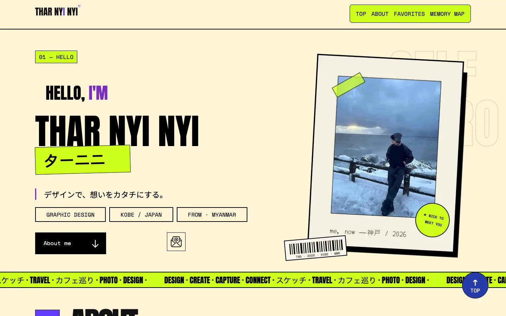
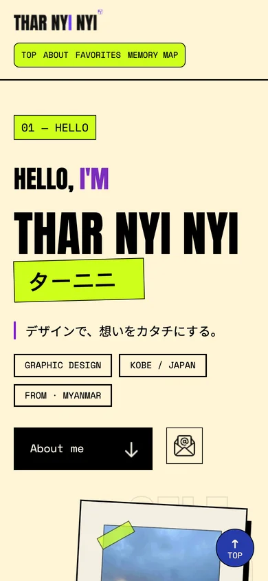

# 自己紹介サイト

Figmaで自分でデザインした自己紹介ページを、HTML / CSSでコーディングしたWebサイトです。

<p>
  
  
</p>

## リンク

- **サイト**：https://tharnyinyi959-create.github.io/self-intro/
- **ポートフォリオでの紹介**：https://tharnyinyi959-create.github.io/work-self-intro.html

## 概要

学校の課題として制作した、1ページの自己紹介サイトです。
Figmaで作ったデザインを、HTMLとCSSだけで再現しました（JavaScriptは使っていません）。

ページの構成：

1. **HELLO** — 名前・ひとこと・写真
2. **ABOUT ME** — プロフィール
3. **FAVORITES** — 好きなもの
4. **MY MEMORY MAP** — 思い出の場所
5. **フッター** — SNS・コピーライト

## 使用技術

| 分類 | 内容 |
|---|---|
| コーディング | HTML / CSS |
| デザイン | Figma |
| 公開・管理 | Git / GitHub / GitHub Pages |

## レスポンシブ対応

`@media` を3つ使い、PC・タブレット・スマートフォンで見やすくなるようにしました。

### 画面幅ごとの変化

| 画面幅 | 主な変化 |
|---|---|
| 1201px以上（PC） | Figmaのデザインどおりのレイアウト。HELLOは文字（左）と写真（右）が横に並ぶ |
| 1200px以下（タブレット・小さいPC） | HELLOの写真が文字の下に移動。左右の余白を40pxにそろえる |
| 600px以下（スマートフォン） | 左右の余白を20pxに。見出しや名前の文字を小さくする。メニューを折り返す。日本語のサブタイトルを見出しの下の行に移動。MEMORY MAPの写真をカードの文章の下に移動。飾りが画面の外にはみ出さないよう位置を調整 |

例：1200px以下で、HELLOの横並びを縦並びにしている部分

```css
@media (max-width: 1200px) {
    #hero {
        flex-direction: column; /* 横並び → 縦並び */
        padding: 0 40px;
    }
}
```

### マウスとタッチで動きを変える

ABOUT MEの写真は、マウスを乗せると表示されるデザインです。
ただしスマートフォンなどのタッチ画面では「マウスを乗せる」ことができないため、`@media (hover: hover)` を使って、**マウスがある端末だけ**この動きにしました。タッチ画面では最初から写真が見えます。

```css
@media (hover: hover) {
    #about .right .border img {
        opacity: 0; /* マウスがある端末だけ、最初は写真を隠す */
    }

    #about .right .border:hover img {
        opacity: 1;
    }
}
```

## 学んだこと・苦労したこと

<!-- ここは自分の言葉で書いてください。下の質問に答えると書きやすいです。
     ・コーディングで一番むずかしかったところは？
     ・どうやって解決した？（調べた・先生に聞いた・試した など）
     ・@media を使ってみて、わかったことは？ -->

- 〇〇
- 〇〇

## 今後やりたいこと

<!-- ここも自分の言葉で。例：JavaScriptで動きを足す、アクセシビリティを良くする など -->

- 〇〇
